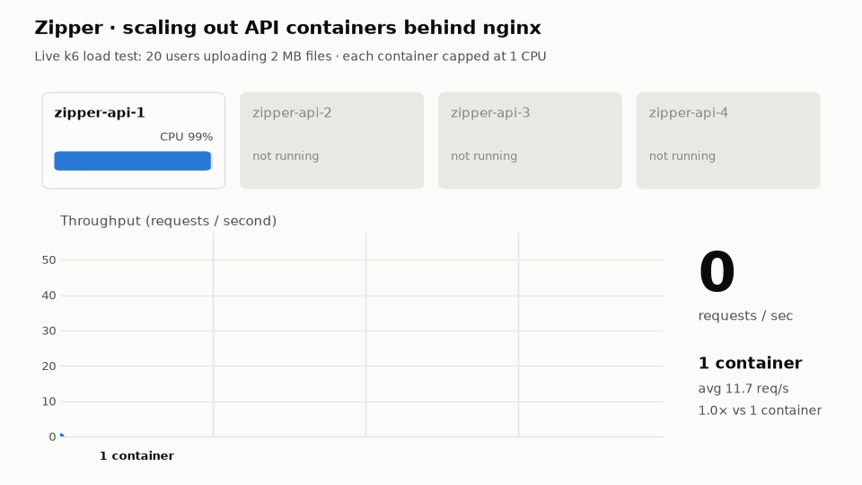

# Zipper

A web-based file compressor built with React, TypeScript, and Express. Upload a file from the browser, the server gzips it, and the compressed `.gz` downloads straight back. The backend is stateless, so it scales horizontally across multiple containers behind an nginx load balancer.

## Screenshots


## Scaling

The API runs as multiple Docker containers behind nginx. Each upload is compressed and returned in a single request, and its temporary files are deleted as soon as the response is sent. No state is shared between requests, so any container can handle any request.



Load tested with [k6](https://k6.io): 20 concurrent users repeatedly uploading 2 MB files, 25 seconds per run, each API container capped at 1 CPU. The load testing and the scaling demo above were done with the assistance of [Claude](https://claude.ai), Anthropic's AI assistant.

| API containers | Requests / second | Speed-up | p95 latency | Success rate |
| --- | --- | --- | --- | --- |
| 1 | 11.7 | 1.0× | 1.91 s | 100% |
| 2 | 24.2 | 2.1× | 0.96 s | 100% |
| 3 | 34.1 | 2.9× | 0.82 s | 100% |
| 4 | 43.4 | 3.7× | 0.67 s | 100% |

## Features

* **File upload** – Pick any file in the browser and send it to the server
* **Gzip compression** – Files are streamed through gzip, so even large files use little memory
* **Instant download** – The compressed file downloads automatically, keeping its original name and extension (`report.pdf` → `report.pdf.gz`)
* **Automatic cleanup** – Uploaded and compressed files are deleted from the server as soon as the download is sent
* **Upload limits** – Files over 100 MB are rejected
* **Health check** – API status shown in the UI, also used by the load balancer
* **Horizontal scaling** – Run any number of API containers with a single command

## Technologies

### Frontend

* **React** – Component-based user interface
* **Vite** – Frontend build tool and development server
* **TypeScript** – Typed frontend development
* **Material UI** – UI components and icons
* **Axios** – HTTP requests and file uploads
* **downloadjs** – Saving the compressed file in the browser

### Backend

* **Node.js + Express** – REST API server
* **TypeScript** – Typed server-side development
* **Multer** – Multipart file uploads with unique file names and size limits
* **zlib** – Streaming gzip compression

### Infrastructure

* **Docker** – Containerised frontend and backend
* **Docker Compose** – Runs and scales the full stack
* **nginx** – Serves the frontend and load balances API requests (`least_conn`)

## Architecture

```text
                    Browser (React + Vite build)
                               │
                               │ HTTP
                               ▼
                 ┌──────── nginx (web) ────────┐
                 │                             │
          static frontend               /api/* load balancer
                                               │
                    ┌──────────────┬───────────┴──┬──────────────┐
                    ▼              ▼              ▼              ▼
               zipper-api-1   zipper-api-2   zipper-api-3   zipper-api-N
                 (Express)      (Express)      (Express)      (Express)
```

## API Endpoints

| Endpoint | Description |
| --- | --- |
| `GET /api/health` | API status and the hostname of the container that answered |
| `POST /api/zip` | Upload a file (multipart field `file`) and receive it back gzipped |

## Project Structure

```text
├── client/                  # React frontend
│   ├── public/              # Static assets
│   ├── src/
│   │   ├── App.tsx          # Upload UI and API calls
│   │   ├── main.tsx         # App entry point
│   │   └── theme.ts         # Material UI theme
│   ├── Dockerfile           # Builds the frontend into an nginx image
│   ├── nginx.conf           # Static hosting + API load balancer
│   ├── package.json
│   └── vite.config.ts
├── server/                  # Express backend
│   ├── src/
│   │   └── index.ts         # API endpoints, upload handling, compression
│   ├── Dockerfile
│   └── package.json
├── docs/                    # README images
├── docker-compose.yml       # nginx + scalable API service
└── package.json             # npm workspaces
```

## Running Locally

### Development

Requires Node.js.

```bash
npm install
npm run dev
```

The backend runs on `http://localhost:3001` and the Vite dev server proxies `/api` requests to it.

### Docker (scaled)

Requires Docker Desktop.

```bash
docker compose up --build -d --scale api=3
```

Open `http://localhost`. Change `--scale api=3` to run more or fewer API containers, then run `docker compose restart web` so nginx picks up the change. Watch requests spread across containers with:

```bash
docker compose logs -f api
```

Stop everything with `docker compose down`.

## Overview

This project of mine developed my understanding of the below:

* React frontend development with TypeScript
* REST API development with Node.js and Express
* Handling file uploads and streaming compression
* Designing a stateless backend so it can scale horizontally
* Load balancing with nginx
* Containerising and scaling an application with Docker and Docker Compose
* Load testing and measuring scalability
* Client-server communication
* Git-based development
